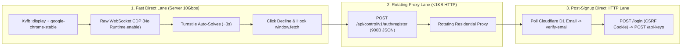

# turnstile-raw-cdp

**Bypassing Cloudflare Turnstile at Scale via Raw Chrome DevTools Protocol (No `Runtime.enable`), Headed `Xvfb` Chrome, and Split-Lane Token Extraction**

A step-by-step technical breakdown and 100% Python standard-library reference implementation explaining why standard browser automation frameworks (Playwright, Puppeteer, Selenium) fail modern Cloudflare Turnstile challenges—and how to build a fast, deterministic solver and end-to-end registration pipeline on Linux servers.

---

## Table of Contents

1. [Why Playwright & Puppeteer Get Caught (`Runtime.enable` Leak)](#1-why-playwright--puppeteer-get-caught-runtimeenable-leak)
2. [Why `headless_shell` & Unbranded Chromium Fail](#2-why-headless_shell--unbranded-chromium-fail)
3. [Architecture Overview: The 4-Layer Bypass](#3-architecture-overview-the-4-layer-bypass)
4. [Step-by-Step Implementation Guide](#4-step-by-step-implementation-guide)
   - [Step 1: Environment Setup (`google-chrome-stable` + `Xvfb` + Mesa)](#step-1-environment-setup-google-chrome-stable--xvfb--mesa)
   - [Step 2: Zero-Dependency Raw CDP Client (Without `Runtime.enable`)](#step-2-zero-dependency-raw-cdp-client-without-runtimeenable)
   - [Step 3: Closed Shadow DOM Clicking & Pre-Submit Promise Unblocking](#step-3-closed-shadow-dom-clicking--pre-submit-promise-unblocking)
   - [Step 4: Split-Lane Token Extraction (Fast Direct Turnstile + Rotating Proxy POST)](#step-4-split-lane-token-extraction-fast-direct-turnstile--rotating-proxy-post)
5. [Case Study: End-to-End IteraCompute (`qwen/qwen3.8-27b`) Account & API Key Pipeline](#5-case-study-end-to-end-iteracompute-qwenqwen38-27b-account--api-key-pipeline)
6. [Repository Structure & Running the Examples](#6-repository-structure--running-the-examples)

---

## 1. Why Playwright & Puppeteer Get Caught (`Runtime.enable` Leak)

Even if you pass `--disable-blink-features=AutomationControlled` and patch `navigator.webdriver = undefined`, Playwright and Puppeteer automatically send the Chrome DevTools Protocol command **`Runtime.enable`** to every page and iframe target upon connection (including the cross-origin `https://challenges.cloudflare.com` Turnstile iframe).

When inspecting console events emitted by Cloudflare Turnstile's challenge script inside an instrumented browser, you will see telemetry probes like this:

```text
startGroupCollapsed:
debug: Error
log: /.*.*=.*/
log: JSHandle@node
count: \u0000: 1
debug: %c%d font-size:0;color:transparent NaN
dir:  OROhR9: RmGBF2
dirxml: %c%d font-size:0;color:transparent OROhR9: RmGBF2
table: %c%d font-size:0;color:transparent OROhR9: RmGBF2
endGroup: console.groupEnd
```

### How the Detector Works in V8 (`v8_console.cc`)

1. Turnstile constructs a JavaScript object (or `Error` instance) with a property getter attached (e.g., property `OROhR9`) and passes it to `console.dir()`, `console.table()`, and `console.debug()`.
2. In Chromium's V8 inspector implementation (`v8_console.cc`), `console.dir` and `console.table` are **no-ops** when no DevTools/CDP session has enabled the `Runtime` domain. The property getter is **never invoked** in a normal user browser.
3. However, as soon as Playwright or Puppeteer sends `Runtime.enable`, V8 serializes the arguments of `console.dir` / `console.table` to build the `Runtime.consoleAPICalled` CDP event. Serializing the object invokes the getter, immediately flagging the session as automated (`! Verification failed`).

### The Fix: `Runtime.evaluate` Without `Runtime.enable`

Chromium's CDP implementation allows calling **`Runtime.evaluate`** (`returnByValue: true`) and **`Input.dispatchMouseEvent`** on a page target **without ever calling `Runtime.enable`**. Because `Runtime.enable` is never sent:
- No `Runtime.consoleAPICalled` serialization occurs.
- Turnstile's `console.dir` / `console.table` property getters never fire.
- We never attach to the cross-origin `challenges.cloudflare.com` iframe target at all.

---

## 2. Why `headless_shell` & Unbranded Chromium Fail

Besides `Runtime.enable`, Turnstile inspects the browser environment inside its challenge worker (`blob:https://challenges.cloudflare.com/...`):

| Signal | Playwright `chromium_headless_shell` | Official `google-chrome-stable` + `Xvfb` |
| :--- | :--- | :--- |
| `navigator.userAgentData.brands` | Contains only `"Chromium"`, missing `"Google Chrome"` | Includes `"Google Chrome"` brand |
| WebGL Renderer | Software fallback (`SwiftShader` deprecation warning) | Mesa Gallium / `llvmpipe` X11 GLX context |
| Display Server | Headless Ozone platform (`--ozone-platform=headless`) | Real X11 display (`DISPLAY=:99` via `Xvfb`) |
| Turnstile Result | `401` on `/h/b/pat/...` $\rightarrow$ `Verification failed` | Auto-solves (`Success!`) in ~2.5–3.5 seconds |

---

## 3. Architecture Overview: The 4-Layer Bypass



---

## 4. Step-by-Step Implementation Guide

### Step 1: Environment Setup (`google-chrome-stable` + `Xvfb` + Mesa)

On an Ubuntu/Debian server, install the official branded Google Chrome binary, Xvfb virtual framebuffer, and Mesa GL drivers:

```bash
curl -fsSL https://dl.google.com/linux/direct/google-chrome-stable_current_amd64.deb -o /tmp/chrome.deb
sudo apt-get update
sudo apt-get install -y /tmp/chrome.deb xvfb libgl1-mesa-dri mesa-vulkan-drivers
```

### Step 2: Zero-Dependency Raw CDP Client (Without `Runtime.enable`)

Instead of importing Playwright or Puppeteer, launch `google-chrome-stable` on an `Xvfb` display with `--remote-debugging-port` and connect to the page target's `webSocketDebuggerUrl` using Python's standard library (`socket`, `struct`, `json`):

```python
def cdp_eval(sock, msg_id: int, expr: str, await_promise: bool = False):
    # Note: Runtime.enable is NEVER called!
    ws_send(sock, {
        "id": msg_id,
        "method": "Runtime.evaluate",
        "params": {
            "expression": expr,
            "returnByValue": True,
            "awaitPromise": await_promise,
        },
    })
    while True:
        msg = ws_recv(sock)
        if msg.get("id") == msg_id:
            return msg.get("result", {}).get("value")
```

### Step 3: Closed Shadow DOM Clicking & Pre-Submit Promise Unblocking

1. **Closed Shadow DOM Fallback Click:**
   Turnstile mounts its `<iframe>` inside a **Closed Shadow Root** (`#shadow-root (closed)`), so `document.querySelector('iframe')` from the main page will not see it. If Turnstile asks for a checkbox click instead of auto-solving, locate the host container relative to the submit button (`btn.previousElementSibling.getBoundingClientRect()`) and dispatch a native mouse click at `(box.x + 28, box.y + box.height / 2)`.
2. **Unblocking Pre-Submit Consent Gates (`window.iteraAttribution.ready`):**
   Inspecting the Next.js bundle (`3a94higtmowq0.js`) reveals a subtle pre-submit gate inside `controlPlaneRequest`:
   ```javascript
   if ("/v1/auth/register" === path || "/v1/auth/google/start" === path) {
     let attr = window.iteraAttribution;
     await attr?.ready;
   }
   ```
   Until the user clicks **`Decline`** or **`Allow`** on the lazy-mounted *"May we record your source?"* modal, `window.iteraAttribution.ready` never resolves and `fetch("/api/control/v1/auth/register")` hangs forever. Clicking `Decline` right before submitting immediately resolves the promise.

### Step 4: Split-Lane Token Extraction (Fast Direct Turnstile + Rotating Proxy POST)

Running a full Chrome browser through a rotating residential proxy is slow and brittle: loading 10–15 MB of Next.js bundles and Cloudflare WASM blobs over a proxy often triggers `ERR_CONNECTION_RESET` or times out.

At the same time, most backends verifying Turnstile tokens via `https://challenges.cloudflare.com/turnstile/v0/siteverify` only validate `{secret, response: turnstile_token}` and do **not** enforce strict IP binding.

**The Split-Lane Pattern:**
1. **Direct Lane (Chrome):** Run Chrome on the server's fast direct connection (no proxy). Wait ~3 seconds for Turnstile to solve (`submitBtn.disabled === false`).
2. **In-Page `window.fetch` Interception:** Before clicking submit, override `window.fetch` inside the page to capture the outgoing registration JSON payload (containing `turnstile_token`) **without sending the request from the server's IP**.
3. **Proxy Lane (Python `urllib`):** Read `window.__regPayload` via `cdp_eval`, terminate Chrome and `Xvfb` immediately, and send the `<1 KB` JSON `POST` through your rotating residential proxy.

---

## 5. Case Study: End-to-End IteraCompute (`qwen/qwen3.8-27b`) Account & API Key Pipeline

[`examples/04_iteracompute_register.py`](./examples/04_iteracompute_register.py) implements the complete end-to-end account creation and API key minting flow for `https://platform.iteracompute.com`:

1. **Turnstile Challenge Discovery (`/api/control/v1/auth/challenge/config`):**
   - The signup page renders Cloudflare Turnstile (`site_key: 0x4AAAAAAFbST_1ZkXSNwxOb`, `action: "register"`).
   - Notably, only `/v1/auth/register` requires `turnstile_token`; subsequent endpoints (`/v1/auth/verify-email`, `/v1/auth/login`, `/v1/api-keys`) do not require Turnstile.
2. **Fast Direct Token Capture (`get_turnstile_payload`):**
   - Launches `google-chrome-stable` on an isolated `Xvfb` display (`:100`–`:299`).
   - Waits for `button[type="submit"].disabled === false` (~3 seconds).
   - Clicks `Decline` on the Privacy Preferences modal so `window.iteraAttribution.ready` resolves.
   - Hooks `window.fetch`, fills `email` + `password` using React's native `HTMLInputElement.prototype.value` setter, checks `#accepted_terms`, clicks submit, and extracts the 773-byte `turnstile_token`.
3. **Proxy Registration (`post_register_payload`):**
   - Sends `POST /api/control/v1/auth/register` (`~900 bytes`) via the rotating proxy (`ITERA_FALLBACK_PROXY`).
   - If the proxy is asleep (`status == 0`), calls `VN_PROXY_ROTATE_URL` to wake/rotate it and **reuses the same `turnstile_token`**.
   - If the current proxy IP hits HTTP `429`, rotates the proxy IP and mints a fresh token.
4. **Cloudflare D1 Email Verification & API Key Minting (`SessionClient`):**
   - Polls Cloudflare D1 (`messages` table populated by a Cloudflare Email Worker catch-all) for `https://platform.iteracompute.com/verify-email?token=...`.
   - Calls `POST /api/control/v1/auth/verify-email` with `{"token": token}`.
   - Calls `POST /api/control/v1/auth/login` and automatically forwards the `__Host-iteracompute_csrf` cookie into the `X-CSRF-Token` request header.
   - Calls `POST /api/control/v1/api-keys` with an `Idempotency-Key` UUID header to mint the `sk-...` API key and appends the record to `keys.jsonl`.

---

## 6. Repository Structure & Running the Examples

```text
.
├── README.md
├── LICENSE
└── examples/
    ├── .env.example                # Environment template (Cloudflare D1 + Rotating Proxy)
    ├── 01_raw_cdp_client.py        # Minimal zero-dependency WebSocket + CDP client
    ├── 02_xvfb_turnstile_solver.py # Headed Chrome + Xvfb Turnstile solver & screenshot tool
    ├── 03_hybrid_split_lane.py     # Generic Split-Lane pattern (direct Turnstile + proxy POST)
    ├── 04_iteracompute_register.py # End-to-End IteraCompute signup + D1 verify + API key minting
    └── 05_farm_loop.sh             # Multi-domain loop wrapper with exponential backoff
```

### Quick Start

```bash
# 1. Configure environment variables for Cloudflare D1 & optional proxy rotation
cp examples/.env.example examples/.env

# 2. Register a single account and mint an API key into keys.jsonl
python3 examples/04_iteracompute_register.py --domain your-catchall-domain.com

# 3. Run the continuous multi-domain loop (default TARGET=500 accounts)
TARGET=500 bash examples/05_farm_loop.sh
```

---

## Disclaimer

This repository is provided for educational purposes, security research, and authorized end-to-end testing of web applications.
